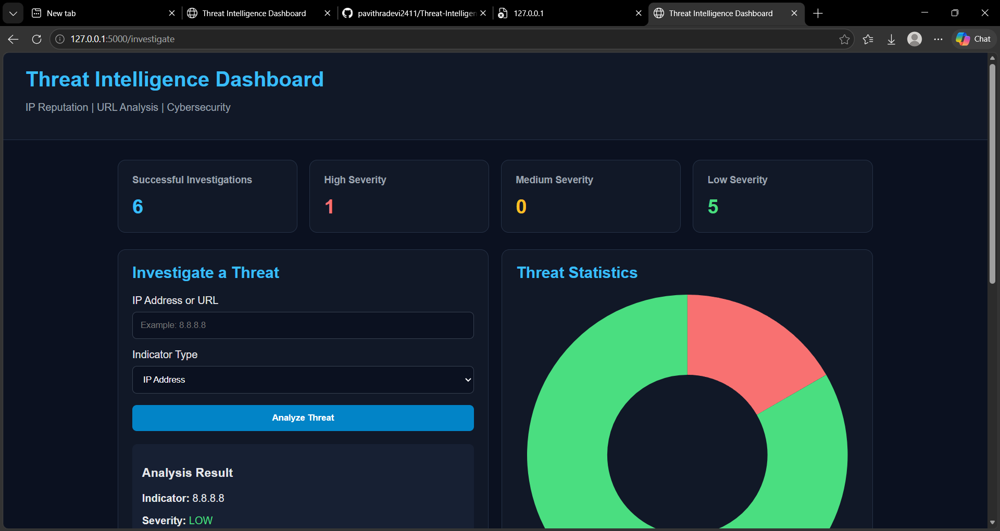
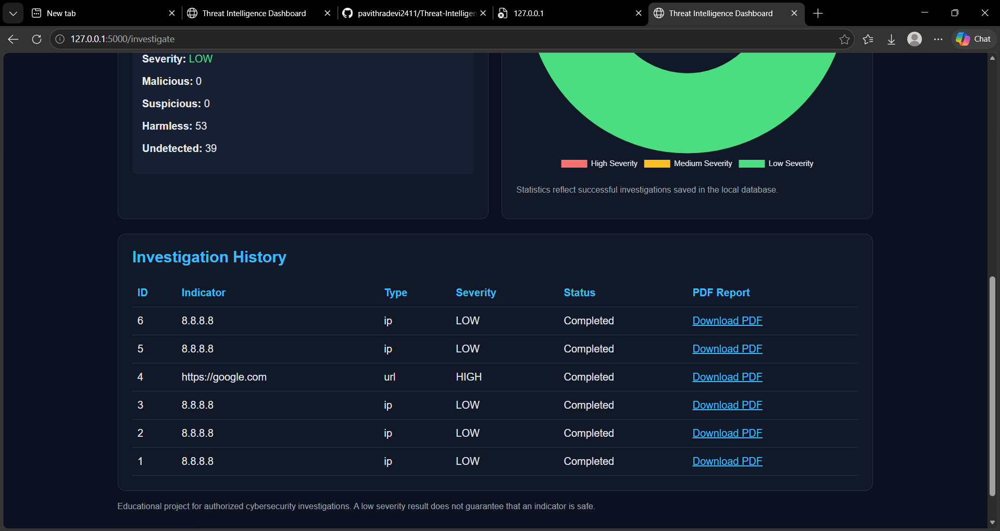

# 🛡️ Threat Intelligence Dashboard

A Python-based cybersecurity web application that investigates IP addresses and URLs using the VirusTotal API v3. The dashboard displays threat intelligence results, classifies threat severity, maintains investigation history, and generates downloadable PDF reports.

## 📸 Dashboard Preview

## 📸 Dashboard Preview

### Main Dashboard



### Additional Dashboard Screenshot



## 📌 Project Overview

The Threat Intelligence Dashboard helps users analyze IP addresses and URLs to understand their potential security risks. It integrates with VirusTotal to retrieve threat detection information and presents the results through a simple web interface.

This project demonstrates practical skills in Python development, API integration, web application development, threat intelligence, database management, and cybersecurity reporting.

## ✨ Features

* **IP Address Investigation:** Analyze IP addresses using VirusTotal.
* **URL Investigation:** Investigate URLs for potential security threats.
* **VirusTotal API Integration:** Retrieve threat intelligence data through the VirusTotal API v3.
* **Threat Severity Classification:** Display threat severity based on the application's classification logic.
* **Detection Statistics:** View malicious, suspicious, harmless, and undetected results when available.
* **Investigation History:** Store investigation records in a local SQLite database.
* **Dashboard Statistics:** Display investigation data and charts.
* **PDF Report Generation:** Generate and download investigation reports.
* **Secure API Key Configuration:** Load the VirusTotal API key through environment variables.

## 🧰 Technologies Used

| Technology        | Purpose                         |
| ----------------- | ------------------------------- |
| Python            | Application logic               |
| Flask             | Web application framework       |
| VirusTotal API v3 | Threat intelligence data        |
| SQLite            | Investigation history storage   |
| HTML and CSS      | Dashboard structure and styling |
| JavaScript        | Dashboard interactions          |
| Chart.js          | Data visualization              |
| Requests          | HTTP API requests               |
| python-dotenv     | Environment variable management |
| ReportLab         | PDF report generation           |

## 📂 Project Structure

```text
Threat-Intelligence-Dashboard/
│
├── templates/
│   └── dashboard.html
│
├── app.py
├── requirements.txt
├── .gitignore
└── README.md
```

The `.env` file and local database are kept out of the public repository.

## ⚙️ Installation and Setup

### 1. Clone the Repository

```bash
git clone https://github.com/pavithradevi2411/Threat-Intelligence-Dashboard.git
```

Navigate to the project directory:

```bash
cd Threat-Intelligence-Dashboard
```

### 2. Create a Virtual Environment

```bash
python -m venv .venv
```

### 3. Activate the Virtual Environment

On Windows PowerShell:

```powershell
.venv\Scripts\Activate.ps1
```

If you are using Command Prompt:

```cmd
.venv\Scripts\activate.bat
```

### 4. Install Dependencies

```bash
python -m pip install -r requirements.txt
```

### 5. Configure the VirusTotal API Key

Create a file named `.env` in the project root directory, alongside `app.py`.

Add the following line:

```text
VT_API_KEY=YOUR_VIRUSTOTAL_API_KEY
```

Replace `YOUR_VIRUSTOTAL_API_KEY` with your own VirusTotal API key.

**Important:** Never commit or upload your `.env` file or API key to GitHub.

### 6. Run the Application

```bash
python app.py
```

Open your browser and visit:

http://127.0.0.1:5000/

Keep the terminal running while you use the dashboard.

## 🔍 How It Works

1. The user submits an IP address or URL through the dashboard.
2. The application sends a request to the VirusTotal API.
3. The application processes the returned threat detection information.
4. The dashboard displays the available detection statistics and severity classification.
5. Investigation records are stored in a local SQLite database.
6. The user can review investigation history and download PDF reports.

## 🧪 Cybersecurity Concepts Demonstrated

* Threat intelligence analysis
* IP address and URL investigation
* REST API integration
* HTTP requests and response handling
* Threat detection statistics
* Web application development
* Database operations using SQLite
* Security reporting and documentation
* Environment variable management

## 🔐 Security Considerations

* Keep API keys and other secrets private.
* Do not upload `.env` files to public repositories.
* Avoid committing local databases containing investigation records.
* Treat VirusTotal results as indicators for further investigation, not conclusive proof that an IP address or URL is malicious or safe.
* Respect VirusTotal API terms and usage limits.
* Test only systems and resources you are authorized to investigate.

## 🚀 Future Enhancements

* Add support for domain and file hash investigations.
* Improve input validation and error handling.
* Add investigation filtering and search.
* Provide more detailed threat analysis summaries.
* Add user authentication and access controls.
* Improve dashboard visualizations and reporting.

## 👩‍💻 Author

**Cybersecurity Project — Threat Intelligence Dashboard**

Developed as a hands-on cybersecurity project to explore threat intelligence, API integration, and security reporting.

## 📄 Disclaimer

This project is intended for educational and authorized cybersecurity investigation purposes. Threat intelligence results may be incomplete or change over time. Always verify findings using additional trusted sources before making security decisions.

